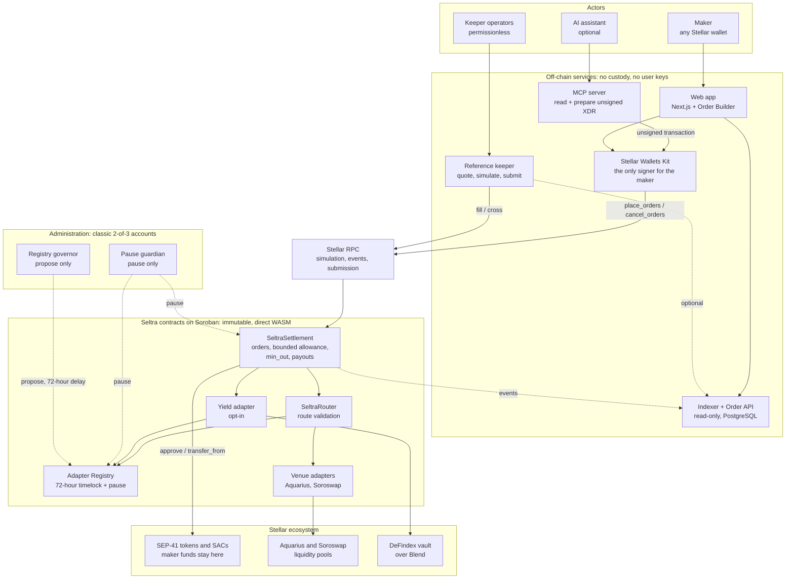
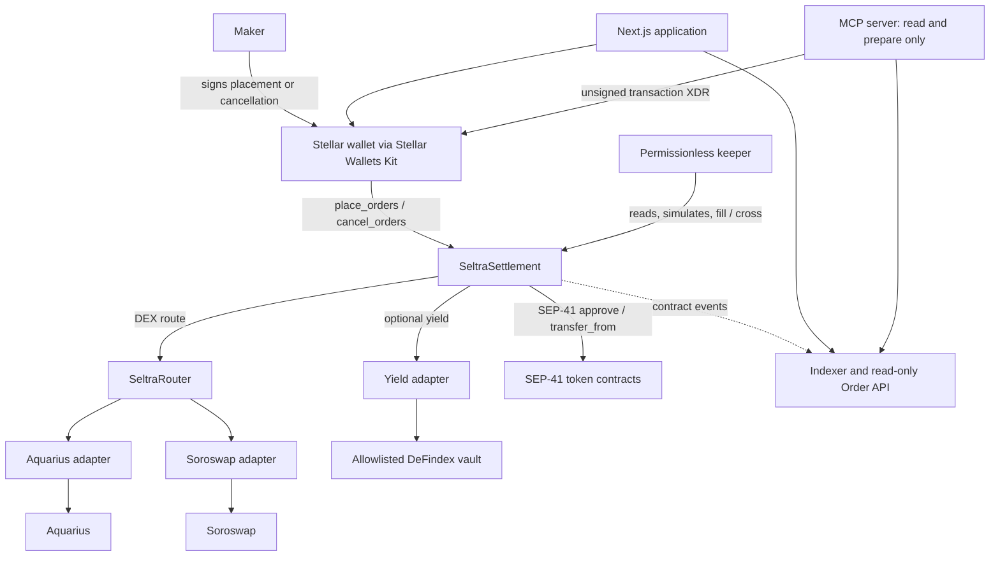
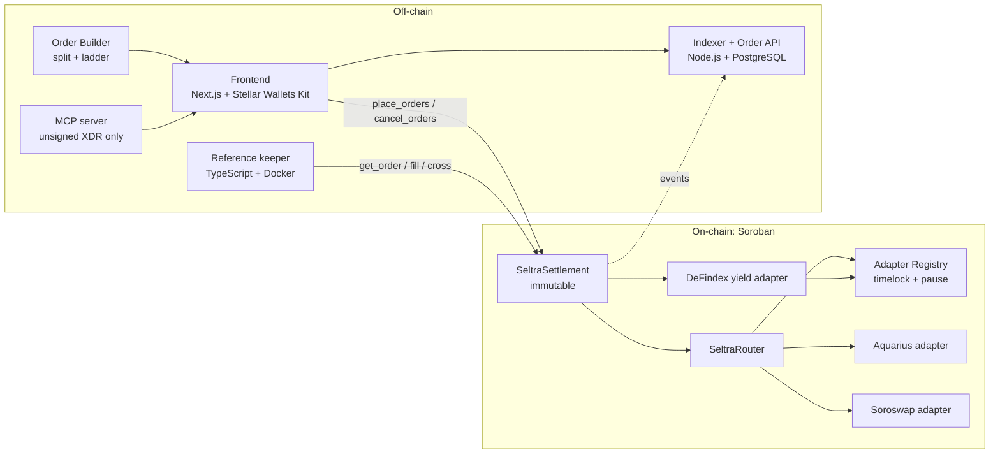

# Seltra Architecture Overview

Programmable, non-custodial limit-order execution on Stellar/Soroban.

> **Status:** consolidated design specification for the SCF Build Open Track; the implementation gates in section 7.5 must be evidenced before contract freeze  
> **Last updated:** 2026-11-10  
> **Source baseline:** Seltra Technical Architecture PDF and SCF Application Build milestones  
> **Numbering note:** sections 1-12 deliberately preserve the source architecture numbering so that the references in `MILESTONES.md` and the SCF application remain valid.

## Project identification

| Field | Value |
| --- | --- |
| Project | Seltra Finance |
| Product | Programmable limit orders on Soroban |
| Network | Stellar |
| Award track | SCF Build, Open Track |
| Repository | To be published under [SeltraFinance](https://github.com/SeltraFinance) |
| Primary team | Seltra Finance |
| Architecture owner | Contract and protocol engineering team |

## Contents

- [High-level architecture](#high-level-architecture)

1. [Overview](#1-overview)
2. [Design Constraints](#2-design-constraints)
3. [Contracts and Core Components](#3-contracts-and-core-components)
4. [Flows](#4-flows)
5. [Keeper Economics](#5-keeper-economics)
6. [Keeper Network, Deployment, and Trust Assumptions](#6-keeper-network-deployment-and-trust-assumptions)
7. [Threat Model and Security Invariants](#7-threat-model-and-security-invariants)
8. [Key Design Decisions](#8-key-design-decisions)
9. [Off-chain Components, Data Stores, and Stack](#9-off-chain-components-data-stores-and-stack)
10. [Testing and Development Environment](#10-testing-and-development-environment)
11. [Integrations and Scope](#11-integrations-and-scope)
12. [Deliverables and Roadmap](#12-deliverables-and-roadmap)

## High-level architecture

This diagram shows the whole system on one page: who acts, which parts run off-chain, which Seltra contracts run on Soroban, and which Stellar protocols Seltra depends on. Sections 1.1 and 1.2 go one level deeper.



How to read it:

- **Signing boundary.** Only the maker's wallet signs placements and cancellations. The web app and the MCP server prepare transactions but hold no keys. Keepers sign only their own fill transactions, which cannot change an order or pay the maker less than `min_out`.
- **Custody boundary.** In default mode the maker's funds stay in their wallet until the fill. In yield mode they sit in the chosen DeFindex vault, with the shares in the maker's wallet. No Seltra contract holds user funds between invocations. Settlement only gets a bounded, time-limited allowance equal to the maker's open orders.
- **Admin boundary.** The pause guardian can pause settlement, an adapter or a vault, but never cancellation, token revocation or expiry. The registry governor can propose new adapters, vaults and caps, but nothing activates before the 72-hour delay. Neither role can move funds or change deployed code.
- **No Seltra dependency for keepers.** Keepers can find orders through events on any Stellar RPC and verify them with `get_order`. The Order API is a convenience, which is why its link to the keeper is drawn dotted.

## 1. Overview

Seltra adds non-custodial limit orders to Soroban automated market makers. A maker places one or more orders with a normal Stellar wallet transaction. Each order contains:

- `token_in` and `token_out`;
- an exact `amount_in`;
- a minimum acceptable output, `min_out`;
- an expiry ledger;
- an optional yield source; and
- the keeper's share of any execution surplus.

In default mode, the input funds remain in the maker's wallet until execution. During placement, the maker authorizes the invocation tree and `SeltraSettlement` sets its SEP-41 allowance to the aggregate amount of that maker's open orders for the input token. The allowance is bounded, time-limited, and never unlimited.

Permissionless keepers observe orders, simulate possible fills, and submit an atomic fill when an order can receive at least `min_out`. Execution has two paths:

1. **DEX path:** the order is routed through an active, allowlisted adapter into Aquarius or Soroswap liquidity.
2. **P2P path:** two opposite Seltra orders whose terms cross settle directly, without an AMM or pool fee.

The maker always receives at least `min_out`. Output above `min_out` is surplus. The order defines the split, with a default of 70% to the keeper and 30% to the maker. Seltra charges no protocol fee and the immutable settlement contract has no fee parameter.

Yield mode is opt-in per order. The maker deposits into an allowlisted, single-asset DeFindex vault during placement. Vault shares remain in the maker's wallet and are redeemed atomically during the eventual DEX fill. Yield above the order's required principal belongs entirely to the maker.

### 1.1 System context



### 1.2 Container view



### 1.3 Component responsibilities and custody

| Component | Primary responsibility | Holds user funds between invocations? |
| --- | --- | --- |
| `SeltraSettlement` | Stores orders, manages bounded allowances, enforces `min_out`, executes fills and crosses, and distributes surplus | No intended token balance between invocations; bounded maker asset/share allowances only |
| `SeltraRouter` | Validates and executes a keeper-supplied route through active adapters | No |
| Venue adapters | Wrap Aquarius and Soroswap behind a common interface | No |
| Adapter Registry | Timelocked allowlist of adapters and vaults, per-integration pause, exposure configuration | No |
| Yield adapter | Deposits into and redeems from an allowlisted DeFindex vault | No |
| Keeper | Reads orders, quotes, simulates, and submits fills | Own fee account only |
| Indexer and Order API | Convenience index of on-chain state and events | No |
| MCP server | Reads, quotes, and prepares unsigned placement or cancellation transactions | No key and no signing capability |

## 2. Design Constraints

### 2.1 SEP-41 allowance model

A token has one allowance per `(owner, spender)`. Calling `approve` replaces the prior value, and the allowance has a single `live_until_ledger`. At each maker-authorized allowance write, Seltra therefore computes one target per maker and actual token contract used by settlement as spender. The two logical aggregates are:

```text
default_asset_allowance(maker, token) =
    sum(order.amount_in for every live open default-mode order of maker selling token)

yield_share_allowance(maker, share_token) =
    sum(order.shares for every live open yield-mode order of maker using share_token)

target_allowance(maker, token_contract) =
    default_asset_allowance(maker, token_contract)
    + yield_share_allowance(maker, token_contract)
```

The allowance expiry is the latest expiry of the covered orders, capped by the token/network maximum live-until ledger. The client does not construct a separate unlimited approval. Revoking the allowance at the token is an independent kill switch for all orders on that token.

The current design limits an order to the network-supported allowance lifetime, approximately six months in the source design. The application defaults to seven days. The exact maximum must be read from the active network configuration during transaction construction rather than hard-coded.

### 2.2 Cancellation liveness and allowance reconciliation

Cancellation must never be blocked by a paused protocol or by a token/vault that rejects an allowance reduction. `cancel_orders` therefore deletes the order first and uses a fallible `try_approve` for the reduction.

The single allowance expiry also means that orders with different expiries cannot each reduce the shared allowance automatically when they expire. This creates two distinct, testable states:

- **Synchronized state:** immediately after a successful settlement-computed `approve`, allowance equals the aggregate live open commitments. Before any individual order expires, each successful fill's `transfer_from` reduces allowance and aggregate by the same committed amount.
- **Stale-capacity state:** either a cancellation-time reduction is rejected, or an order expires before the shared allowance's final `live_until_ledger`. The deleted/expired order is permanently unfillable. Allowance can temporarily exceed the live aggregate, but remains finite and time-limited; `transfer_from` is unreachable without a live order. The next successful maker-authorized allowance update reconciles it to the current aggregate; otherwise the stale capacity expires at the existing allowance bound.

When a fallible reduction is rejected, settlement emits:

```text
allowance_sync_failed(
    maker,
    token_contract,
    attempted_target,
    retained_allowance,
    live_until_ledger,
    error_code
)
```

The event is an operational warning, not a fill capability. Natural expiry-driven staleness is derived from order and allowance state instead of emitting this error event. The indexer and application surface either condition until a later successful maker-authorized placement/cancellation update restores the computed target or the retained allowance expires.

Accordingly, strict allowance equality is a synchronization-point invariant, not a continuous invariant. Cancellation/expiry liveness, unfillability, and finite expiry are the safety properties in stale-capacity state. The implementation and threat-model tests must not claim unconditional equality.

### 2.3 Authorization model

`place_orders` and `cancel_orders` call `maker.require_auth()`. The compatibility path requires the maker to be the source account of the Soroban transaction, so the wallet's normal transaction signature authorizes the complete, simulated invocation tree. This avoids requiring wallets to create separate Soroban authorization-entry signatures.

Contract-owned token movement must use narrowly scoped invocation authorization:

- direct calls made by the current contract are authorized as that contract;
- deeper calls, such as router-to-token or adapter-to-venue pulls on behalf of an upstream contract, require exact `authorize_as_current_contract` entries;
- authorization entries must bind the called contract, function, token, amount, source, destination, and sub-invocation tree;
- no durable unlimited approval is permitted between Seltra contracts or venues.

Tests must use explicit authorization mocks or real invocation trees. A permissive test helper that accepts non-root authorization can hide a missing `authorize_as_current_contract` call and is not sufficient for these paths.

### 2.4 Storage and expiry

- Orders and per-maker order books use temporary contract storage with TTL covering the order expiry.
- Expiry is always checked from the stored order value, never inferred solely from storage TTL.
- Each maker has a persistent nonce. Restoring archived state must never reset it.
- Order identifiers are `(maker, nonce)`, eliminating a global order counter and maker-to-maker write contention for default-mode placement. Yield-mode placement additionally updates one shared exposure key per vault and can therefore conflict with another placement using the same vault.
- Each maker may have at most 64 open orders per input token.
- Storage rent is paid by the maker during placement and is not refunded.

### 2.5 Resource bounds

The architecture snapshot uses the following October 2026 mainnet transaction limits:

| Resource | Snapshot limit |
| --- | ---: |
| CPU instructions | 400,000,000 |
| Memory | 40 MiB |
| Ledger entries read | 200 |
| Ledger entries written | 200 |
| Ledger bytes written | 132 KB |
| Contract event bytes | 16 KB |

These are validator-controlled network settings, not protocol constants. CI and release testing must query current network settings. Route depth, `MAX_CROSSES`, and the 64-order cap are finalized from measured resource use so that the deepest route, a maximum cross batch, and a 20-order ladder each remain at or below 50% of every active per-transaction limit.

### 2.6 Immutability and migration

`SeltraSettlement` exposes no upgrade entrypoint and must contain no reachable call to update its current WASM. A defect requires deployment of a new settlement version and explicit migration. Every order expires within the bounded allowance lifetime, which limits the migration horizon.

For the award deployment, the settlement, router, registry, and Seltra-owned adapters are deployed from direct `Wasm(hash)` executables, not mutable executable references, and contain no reachable executable-update path. Their addresses and resolved WASM hashes are published in the deployment manifest. A replacement is a new contract address activated through the registry timelock; allowlisting is not a substitute for code immutability. External venue and vault upgradeability remains an explicit integration trust decision and is handled in sections 3.5-3.6.

### 2.7 Operating envelope

- Reference keeper: 1-2 vCPU and less than 2 GiB RAM, any Stellar RPC endpoint, a funded fee account, and channel accounts; no archival history required.
- Self-hosted RPC planning baseline: 4-8 vCPU, 16 GiB RAM, and approximately 350 GiB SSD at seven-day event retention.
- Indexer: PostgreSQL and continuous ingestion that stays within the RPC event-retention window.

Hardware, retention, rent, fee, and liquidity figures are planning snapshots. Deployment runbooks must record the measured values used at release time.

## 3. Contracts and Core Components

### 3.1 `SeltraSettlement`

`SeltraSettlement` is the only Seltra contract with a persistent spender role over maker-owned input assets or vault shares. Router, adapter, venue, and vault calls can still appear in narrowly scoped invocation-authorization trees. Settlement is initialized by:

```text
__constructor(pause_guardian, registry, router)
```

The three addresses are immutable configuration. The deployment manifest additionally pins their resolved WASM hashes. In particular, `fill` can call only the configured router; a keeper cannot substitute a router address in calldata. The router and registry must pass the direct-WASM/no-upgrade gate in section 2.6 before the settlement deployment is accepted.

| Method | Caller | Behavior |
| --- | --- | --- |
| `place_orders(maker, Vec<OrderParams>) -> Vec<OrderId>` | Maker, via `require_auth` | Validates each order, assigns `(maker, nonce)`, stores it with sufficient TTL, updates the maker book, and sets the bounded aggregate allowance. In yield mode, deposits through the yield adapter first. Emits `order_placed`. |
| `cancel_orders(maker, Vec<OrderId>)` | Maker | Deletes the orders and attempts to lower the allowance with `try_approve`. Never pausable. |
| `fill(id, route, keeper)` | Anyone | Executes one whole order through the DEX path. |
| `cross(Vec<(OrderId, OrderId)>, keeper)` | Anyone | Crosses up to `MAX_CROSSES` opposite order pairs. |
| `get_order(id)` | Anyone | Returns canonical order state. |
| `open_orders(maker, token)` | Anyone | Returns the maker's open orders for a token. |
| `pause()` / `unpause()` | Guardian | Blocks placement, DEX fills, and crosses. Never blocks cancellation, token revocation, or expiry. |

Placement rejects an order unless all of the following hold:

- `token_in != token_out`;
- `amount_in > 0` and `min_out > 0`, both representable as token `i128` amounts;
- `0 <= surplus_bps <= 10_000`;
- `current_ledger < expiry <= current_ledger + max_order_lifetime`, where the upper bound also fits the token's live allowance window;
- the placement batch, maker book, per-maker/per-token 64-order cap, and yield cap remain within their measured bounds; and
- every addition, subtraction, conversion, and payout calculation succeeds under checked arithmetic.

Surplus multiplication uses a 256-bit non-negative intermediate, or an equivalently proven checked `mul_div_floor`, before range-checking the result back to `i128`. No wrapping or saturating arithmetic is allowed in value movement.

### 3.2 Order data model

| Field | Meaning |
| --- | --- |
| `id` | `(maker, nonce)` |
| `token_in`, `token_out` | SEP-41 contract addresses |
| `amount_in` | Exact input in default mode; principal target in yield mode, subject only to the active vault's maximum one-base-unit rounding tolerance; an order fills completely or not at all |
| `min_out` | Minimum output that must actually increase the maker's balance, not merely arrive at settlement |
| `expiry` | Last ledger at which the order may fill |
| `yield_source` | `None` or an allowlisted DeFindex vault |
| `shares` | Yield-mode vault shares committed to the order |
| `surplus_bps` | Keeper share of surplus; default `7_000` basis points |

### 3.3 Common fill rules

For a default-mode order, settlement calls:

```text
transfer_from(spender = settlement,
              from = maker,
              to = settlement,
              amount = amount_in)
```

The settlement contract is both spender and direct caller, so the maker does not sign at fill time. A pre/post balance-delta check must confirm that exactly `amount_in` arrived, rejecting a detectable transfer fee or non-conserving token. Route output is also measured by settlement balance delta and never trusted from an adapter's return value.

Before payout, settlement builds a checked payout map keyed by `(token, recipient)` and coalesces aliases. This is required because self-fill permits `keeper == maker`, and a P2P keeper may equal either maker. Settlement snapshots every unique recipient balance, makes at most one payout per map entry, and requires the final balance delta to equal that entry's exact aggregate. Independently, every maker-entitlement component must be at least that order's `min_out`. The same rule applies to both token directions in a P2P cross and to yield returned before a DEX swap. Any detectable transfer fee on a recipient payout reverts the complete invocation.

This guarantee is denominated in balance units reported by a standards-conforming SEP-41 token contract. A token contract that deliberately falsifies its own `balance` result is outside the enforceable trust boundary and must not be presented as a supported asset.

After a successful fill, the order is deleted. The token's `transfer_from` reduces the maker's allowance by exactly `amount_in`. For every protocol-controlled address and route token, the balance after the invocation must equal the balance before it; Seltra never consumes, sweeps, or counts unsolicited dust.

### 3.4 `SeltraRouter` and venue adapters

The router exposes:

```text
route(route, token_in, amount_in, source, recipient)
quote(route, amount_in)
```

Each venue adapter exposes a common interface:

```text
swap(token_in, token_out, amount_in, min_out, to)
quote(token_in, token_out, amount_in)
```

Settlement supplies `source = settlement` and `recipient = settlement`; the configured router rejects any other source for a settlement fill. The router validates the complete route, the first input token, route continuity, maximum depth, and every adapter against the registry before the first token movement. An unknown, inactive, paused, wrong-version, or wrong-address adapter causes a revert.

The router never takes custody and has no admin privilege, standing token approval, or durable token allowance. A narrowly scoped authorization supplied by the current upstream contract for one simulated invocation is not a standing router permission.

The exact token and authorization path for every hop is:

1. Settlement validates the order and calls only its immutable configured router address.
2. Before that call, settlement creates one exact `authorize_as_current_contract` entry for the deeper SEP-41 `transfer(source = settlement, to = first_adapter, amount = amount_in)` sub-invocation. The entry is nested under the precise router call and binds router, function, route, `token_in`, amount, source, recipient, and all permitted sub-invocations.
3. The router validates the full route and registry records before executing the authorized transfer directly from settlement to the first adapter; the router is never a token owner or intermediary.
4. Each adapter snapshots its input balance, validates the expected exact hop input, and authorizes only the venue's exact pull from that adapter with its own `authorize_as_current_contract` entry.
5. The venue sends hop output directly to the next already-validated adapter or the final settlement recipient. The router measures each receiver delta before advancing the route and never trusts a returned amount.
6. Settlement verifies final output and recipient deltas. Every protocol-controlled route-token balance must equal its pre-invocation balance; in ordinary zero-prefill tests, each is zero before and after.

This invocation tree must be encoded and tested explicitly before the Tranche 1 contract freeze. Direct calls need no extra contract authorization, but every deeper call that requires an upstream contract's authority must match the exact entry; wildcard or durable authorization is forbidden.

| Venue | Wrapped entrypoint |
| --- | --- |
| Aquarius | `swap_chained(user, swaps_chain, token_in, in_amount: u128, out_min: u128)` with checked amount conversions |
| Soroswap | `swap_exact_tokens_for_tokens(amount_in, amount_out_min, path, to, deadline)` |

### 3.5 Adapter Registry, pause guardian, and registry governor

Administrative roles are deliberately separated:

| Role | Authentication | Powers |
| --- | --- | --- |
| Pause guardian | Published classic Stellar 2-of-3 account with hardware-wallet signers and at least one outside signer | Pause/unpause settlement, an adapter, or a vault integration; cannot propose integrations, change caps, replace code, move funds, or alter orders |
| Registry governor | Separate published classic Stellar 2-of-3 account with hardware-wallet signers and at least one outside signer | Propose adapter/vault records and exposure-cap changes; cancel its own pending proposal; cannot bypass the delay or spend user funds |
| Activator | Permissionless | Activate an unchanged mature proposal after its delay |

Adapters use a two-step activation process:

```text
registry_governor.require_auth()
propose_adapter(address, expected_wasm_hash, interface_version, route_constraints)
    -> 72-hour ledger-timestamp delay
    -> permissionless activate_adapter(proposal_id)
```

Vaults and cap changes follow the same model through `propose_vault`, `propose_vault_cap`, permissionless activation, and emergency pause. Activation accepts only the exact proposal payload committed before the delay; editing any address, hash, interface version, asset, or cap creates a new proposal and restarts the delay. Cap decreases are also timelocked; the guardian can pause immediately when a faster risk reduction is needed.

The immutable registry stores `(address, expected_wasm_hash, interface_version, status, constraints)` and emits proposal, activation, pause, and unpause events. Seltra-owned adapters must be direct-WASM immutable deployments matching the published hash. Release tooling resolves and verifies the on-ledger executable before proposal and again before activation. A changed integration is admitted only as a new address/hash proposal.

At mainnet launch both administrative accounts have three hardware-wallet signers and threshold 2. At least one signer of each account is outside the team. Native account multisig is used instead of introducing another governance contract. These roles are explicit trust assumptions and all actions are public on-chain.

### 3.6 Yield adapter

Yield is optional and only available for a registry-approved DeFindex vault that is:

- single-asset;
- denominated in the order's `token_in`;
- non-upgradable on the allowlisted deployment;
- activated after the 72-hour timelock; and
- below a settlement-enforced exposure cap.

Each vault proposal commits to its address, underlying asset, share-token address, resolved direct WASM hash, interface version, and a rounding tolerance of at most one underlying base unit. Before activation, release tooling proves from ledger state that the instance uses the proposed direct `Wasm(hash)` rather than an external executable reference, and review of that exact WASM finds no reachable executable-update path. If this cannot be shown, the vault is treated as upgradable and is ineligible. The hash and evidence are published during the 72-hour review window.

The exposure cap is measured in underlying-asset base units of committed Seltra principal, not in shares or current vault value:

```text
VaultExposure(vault) = sum(order.amount_in for live yield-mode orders using vault)
```

Placement atomically checks and increments the shared per-vault counter by `amount_in`; fill or cancellation atomically decrements it by the same value. All counter arithmetic is checked and a batch aggregates its vault deltas before writing. This shared key is why the no-maker-contention claim applies only to default mode.

Placement deposits into the vault from the maker inside the maker-authorized invocation. The maker's `require_auth` tree covers the exact deposit and the share-token `approve(maker, settlement, aggregate_shares, live_until_ledger)`. Shares are minted to the maker, not Seltra, and settlement receives only that bounded allowance on the share token.

At fill time, settlement directly calls `share_token.transfer_from(spender = settlement, from = maker, to = yield_adapter, amount = shares)` and confirms the exact share delta. The yield adapter then authorizes only the vault's exact redemption pull from itself with `authorize_as_current_contract`. Redemption and the subsequent DEX fill occur in the same invocation. The swap input is:

```text
require redeemed_assets + vault_rounding_tolerance >= amount_in
swap_input = min(redeemed_assets, amount_in)
```

The addition is checked. `vault_rounding_tolerance` is fixed in the active registry record and cannot exceed one underlying base unit. A greater shortfall is treated as vault-value loss: the whole invocation reverts, no shares are consumed, and the order remains live. A shortfall within the disclosed one-unit tolerance is the only yield-mode exception to exact `amount_in` input.

Assets above `amount_in` are accrued yield and return entirely to the maker. They are not part of keeper surplus. Settlement snapshots the maker's underlying balance around that transfer and requires an exact increase equal to the returned yield. If redemption cannot provide the permitted principal and the routed trade cannot provide `min_out`, the whole fill reverts and the maker's shares remain unchanged.

Keepers must simulate the concrete allowlisted vault's real redemption/unwind path before submission. The exact DeFindex contract version and its deposit, withdrawal, preview, share-token, and authorization interfaces are pinned at activation and tested against that deployed code. A generic `preview_redeem` result alone is not proof of immediately available liquidity.

On cancellation, shares remain in the maker's account and the share allowance is reduced under the same reconciliation rules as default-mode orders. The maker may withdraw directly from the vault. No Seltra contract holds shares between invocations.

### 3.7 On-chain storage map

| Key or store | Storage class | Purpose |
| --- | --- | --- |
| `Order(maker, nonce)` | Temporary | Canonical order state through expiry |
| `MakerBook(maker, token)` | Temporary | Bounded list of open order IDs; prunes expired entries |
| `Nonce(maker)` | Persistent | Monotonic order-ID source; never reset after archival restore |
| Pause guardian, registry, and router addresses | Instance/persistent configuration | Immutable administrative and routing references fixed at construction |
| Adapter/vault/cap proposals and active records | Registry contract storage | Governor-authenticated payload, 72-hour timelock, hashes, interface versions, caps, and pause state |
| `VaultExposure(vault)` | Settlement storage | Checked sum of live yield-order principal in underlying base units |

## 4. Flows

### 4.1 Placement and DEX fill

```mermaid
sequenceDiagram
    actor Maker
    participant Settlement as SeltraSettlement
    participant Token as SEP-41 token
    participant Keeper
    participant Router as SeltraRouter
    participant Adapter
    participant Venue as Aquarius/Soroswap

    Maker->>Settlement: place_orders(maker, [order])
    Settlement->>Settlement: validate, store, update maker book
    Settlement->>Token: approve(maker, settlement, aggregate, latest expiry)
    Settlement-->>Keeper: order_placed event
    Keeper->>Keeper: quote and simulate via Stellar RPC
    Keeper->>Settlement: fill(id, route, keeper)
    Settlement->>Token: transfer_from(settlement, maker, settlement, amount_in)
    Settlement->>Settlement: authorize exact nested token transfer
    Settlement->>Router: route(route, token_in, amount_in, settlement, settlement)
    Router->>Adapter: exact hop input + swap(...)
    Adapter->>Venue: invocation-authorized exact pull / swap
    Venue-->>Settlement: output
    Settlement->>Settlement: measure route output; compute checked payouts
    Settlement->>Settlement: coalesce payouts by token + recipient
    Settlement-->>Maker: maker entitlement (plus keeper share on self-fill)
    Settlement-->>Keeper: keeper entitlement when a distinct recipient
    Settlement->>Settlement: assert exact recipient deltas; delete order
```

Every step is atomic. Any failure reverts the transaction, leaving the order and balances unchanged. A keeper that submits a failed transaction pays its network fee; simulation has no on-chain transaction fee but still consumes RPC and operator resources.

### 4.2 Batch placement: split and ladder

One `place_orders` call can create multiple independent orders with one maker signature:

- A **split** creates slices at the same price, allowing progressive execution and better fit for thin pools.
- A **ladder** creates orders at stepped prices on one token pair.

Each slice has its own ID, expiry, cancellation, and all-or-nothing fill. Seltra does not automatically re-place a filled order.

### 4.3 P2P cross

Let order A sell `a_in` of X for at least `a_min` of Y. Let order B sell `b_in` of Y for at least `b_min` of X.

Every pair is validated before any token moves:

1. `cross` is not paused.
2. `1 <= number_of_pairs <= MAX_CROSSES`.
3. No order ID appears twice in the call.
4. Both orders exist and are not expired.
5. Tokens are mirrored: `A.token_in == B.token_out` and `A.token_out == B.token_in`.
6. Both orders are in default mode; yield-mode orders use the DEX path only.
7. Prices cross: `b_in >= a_min` and `a_in >= b_min`.

Payouts are computed independently in each output token and rounded down:

```text
keeper_Y = floor((b_in - a_min) * A.surplus_bps / 10_000)
keeper_X = floor((a_in - b_min) * B.surplus_bps / 10_000)

A receives b_in - keeper_Y
B receives a_in - keeper_X
```

All subtractions, multiplications, divisions, and conversions use checked arithmetic with a 256-bit non-negative intermediate (or an equivalent proven `mul_div_floor`). Execution order is validate all pairs, delete orders and update maker books, pull inputs with exact delta checks, coalesce a checked payout map by `(token, recipient)`, snapshot each unique recipient, pay each map entry once, assert every exact aggregate recipient delta and both maker-entitlement `min_out` values, then assert unchanged settlement balances. One invalid pair reverts the entire batch. Crosses are whole-order, one-to-one matches and do not call an AMM.

### 4.4 Cancellation

1. Maker authorizes `cancel_orders`.
2. Settlement verifies ownership and live status.
3. Settlement deletes the order and updates the maker book.
4. Settlement attempts to reduce the applicable token or share allowance.
5. A rejected allowance update emits `allowance_sync_failed` with the attempted target, retained allowance, expiry, and error code, but cannot resurrect or fill the deleted order.

Cancellation remains available while fills, crosses, placements, an adapter, or a vault are paused.

### 4.5 Yield-mode placement and fill

1. Maker selects an active vault and explicitly accepts its additional risk.
2. Placement validates asset, upgrade status, cap, and registry activation.
3. The vault deposits the maker's assets; shares are minted to the maker.
4. Settlement records the share commitment and bounded share allowance.
5. Keeper simulates the actual redemption path and underlying venue route.
6. Fill atomically redeems shares, rejects a principal shortfall greater than the active vault's maximum one-base-unit rounding tolerance, returns yield above principal to the maker with an exact recipient-delta check, swaps at most `amount_in`, enforces `min_out` at the maker, and distributes only trading surplus.

## 5. Keeper Economics

For a DEX fill:

```text
surplus = actual_output - min_out
keeper_payout = floor(surplus * surplus_bps / 10_000)
maker_payout = actual_output - keeper_payout
```

The calculation uses checked wide intermediates and is only valid for `0 <= surplus_bps <= 10_000`. The default `surplus_bps` is `7_000`, so the keeper receives 70% of surplus and the maker receives 30%. Settlement verifies `maker_payout >= min_out` and then verifies exact aggregate deltas for every unique payout recipient; on self-fill the maker and keeper amounts are coalesced. The maker's limit price is guaranteed while keepers fund infrastructure, RPC access, channel accounts, and lost-race fees.

The protocol takes no fee. The maker pays the placement transaction fee and storage rent once. The source estimates approximately 0.02-0.03 XLM for a seven-day order and 0.1 XLM for a six-month order at its then-current network settings; these figures must be measured and published again at release time.

The application enforces a USD 10 minimum per order and per slice using a current venue quote. The contract does not enforce a fiat minimum because that would require an oracle in the settlement path.

Examples from the design:

- **DEX:** sell 1,000 XLM with `min_out = 500 USDC`; route output is 507 USDC. Maker receives 502.1 USDC and keeper receives 4.9 USDC.
- **P2P:** A sells 1,000 XLM for at least 290 USDC; B sells 300 USDC for at least 980 XLM. A receives 293 USDC, B receives 986 XLM, and the keeper receives 7 USDC plus 14 XLM.

Yield is never keeper surplus. Any redeemed value above `amount_in` returns to the maker before the trading-surplus calculation.

## 6. Keeper Network, Deployment, and Trust Assumptions

### 6.1 Keeper capabilities

A keeper may choose which eligible orders to fill, when to fill them, and which active route to use. It cannot:

- hold maker funds between invocations;
- alter an order;
- pay the maker less than `min_out`;
- use an inactive venue;
- fill a cancelled, filled, or expired order; or
- sign for the maker.

The first valid fill wins. A second fill against the same order fails. Stellar orders transactions at ledger granularity, so operational speed matters around the roughly five-second ledger cadence rather than sub-millisecond matching.

### 6.2 Discovery without Seltra infrastructure

Keepers can read `order_placed` events from any Stellar RPC and verify every candidate with `get_order`. The default seven-day order expiry aligns with a typical seven-day RPC event-retention window. Older live orders require an event indexer or another retained event source. The Seltra Order API is a convenience layer and never a settlement dependency.

### 6.3 Decentralization plan

| Measure | Delivery stage |
| --- | --- |
| Orders stored on-chain and readable through any RPC | Tranche 1 |
| Open-source reference keeper, one-command Docker image, able to operate with the Order API disabled | Tranche 2 |
| Public metrics: distinct keeper addresses, largest keeper share, and last-fill age | Tranche 2 |
| Self-fill from the application | Tranche 2 |
| Two of three launch keepers operated outside the team and evidenced on-chain | Tranche 3 |
| Unprivileged team backstop keeper | Ongoing |

### 6.4 Trust by phase

| Phase | User trusts | User does not need to trust |
| --- | --- | --- |
| Testnet | Contract behavior under test | Custody by Seltra, keepers, frontend, or API |
| Mainnet launch | Immutable settlement/router/registry; bounded allowance; 2-of-3 pause guardian and separate 2-of-3 registry governor, each with an external signer; public addresses and hashes; 72-hour integration/cap changes; selected immutable vault in yield mode | Keepers for custody or minimum output; a venue for successful settlement, because a bad route must revert |
| Post-award | Same contracts; open keeper set; majority of pause-guardian and registry-governor signers outside the team | Same as mainnet launch |

### 6.5 Deployment topology

| Environment | Purpose | Required evidence |
| --- | --- | --- |
| Local network | Contract, auth-tree, adversarial, resource, and integration development | Re-runnable tests and seed scripts |
| Stellar testnet | Public wallet, keeper, venue, indexer, MCP, and yield validation | Published addresses, transaction hashes, operator walkthroughs, monitoring |
| Stellar mainnet | Production protocol | Reproducible WASM, verified hashes, frozen reviewed commits, pause-guardian/registry-governor/timelock configuration, runbooks |

Infrastructure comprises a self-hosted Stellar RPC node with a fallback provider, PostgreSQL for the indexer, Dockerized keeper and services, and CI for Rust and TypeScript. Keeper submissions use channel accounts to avoid a single source-account sequence bottleneck.

### 6.6 Monitoring and operations

At minimum, production monitoring covers:

- keeper liveness and concentration;
- last fill age;
- fills exactly at `min_out`;
- adapter and vault proposal, activation, and pause events;
- pause-guardian and registry-governor actions;
- order and contract TTL headroom;
- allowance/order inconsistencies;
- indexer lag relative to RPC retention;
- RPC health and failover; and
- yield redemption failures or liquidity waits.

Incident, settlement pause, adapter pause, vault pause, RPC failover, and migration runbooks must be exercised before mainnet completion.

## 7. Threat Model and Security Invariants

### 7.1 Attacker model

The threat model assumes an attacker controls every public argument, transaction ordering and timing, keeper behavior, frontend inputs, and contracts that mimic expected interfaces. Soroban host guarantees are relied on for invocation atomicity, replay protection, and the platform's cross-contract execution rules.

### 7.2 Principal threats and protections

| Threat | Protection |
| --- | --- |
| Drain resting contract balances | No user value is intentionally retained; protocol-controlled balances must be unchanged across a call and unsolicited dust is ignored and never swept |
| Excessive allowance | Separate default-asset and yield-share aggregates, finite expiry, no unlimited approval; a rejected reduction is observable and remains unfillable |
| Malicious token or adapter | Exact source, route-output, and final-recipient balance deltas; standards-conforming SEP-41 support boundary; allowlist; route validation; unchanged end-of-call balances |
| Maker removes balance/allowance or pool liquidity | Simulation detects most failures; atomic fill reverts without committing another user's funds |
| Oracle manipulation | No oracle in default settlement; execution price is judged only against `min_out` |
| Thin AMM liquidity | Fill waits if `min_out` is not met; split orders fit available depth |
| AMM price manipulation | Maker still receives at least `min_out`; principal is protected, though surplus may be reduced |
| Spam | Maker pays rent; maximum 64 open orders per maker and input token |
| Compromised frontend, AI agent, or MCP server | Wallet displays and signs every transaction; MCP holds no key; allowance is bounded to orders |
| Hostile pause guardian | Can pause/unpause placement or integrations, but cannot change allowlists/caps, spend, or block cancellation, token revocation, or expiry |
| Hostile registry governor | Can propose a bad integration or cap, but cannot activate before 72 hours; public proposal monitoring and emergency pause provide the review/response window |
| Issuer freeze, clawback, or missing trustline | Simulation and atomic revert; issuer flags shown before signing; cancellation remains available |
| Illiquid or impaired vault | Concrete redemption simulation, exposure cap, explicit opt-in risk, direct maker withdrawal |
| Stale allowance after a rejected reduction or earlier individual order expiry | Deleted/expired order is unfillable; no `transfer_from` without a live order; bounded expiry and later maker-authorized reconciliation |

### 7.3 Explicit loss surfaces

1. A phished or compromised frontend induces the maker to sign an order with a worthless `min_out`; exposure is bounded by the finite allowance the maker authorized.
2. A defect in the settlement fill path can expose the current finite allowance for that asset or share token. This can include stale cancelled- or expired-order capacity until a later successful maker-authorized update or allowance expiry, but it cannot reach unrelated wallet assets.
3. A classic-asset issuer freezes or claws back balances.
4. An allowlisted yield vault loses value; the maker accepts this additional risk when opting in and exposure is capped per vault.

### 7.4 Thirteen test invariants

The test suite must map every invariant to one or more named tests.

1. **Minimum output at recipient:** after every DEX fill or P2P cross, each maker-entitlement component is at least `min_out`; every unique `(token, recipient)` balance increases by the exact aggregate of its maker/keeper entitlements, including self-fill aliasing.
2. **Conservation:** exactly `amount_in` leaves the maker in default mode; in yield mode, committed shares fund a redemption whose principal shortfall is no greater than the disclosed one-base-unit maximum. Nothing leaves on failure, and route output equals the sum of exact coalesced recipient deltas.
3. **Bounded allowance and order cap:** at every successful synchronization point, each default-asset allowance equals live `amount_in` commitments and each yield-share allowance equals live `shares` commitments; allowance is never unlimited and no aggregate covers more than 64 open orders per maker and token. A rejected cancellation reduction or an earlier individual order expiry can create only finite, time-bounded stale capacity with no live spend path; the next successful maker-authorized settlement-computed `approve` reconciles it, or the shared allowance expires at its existing bound.
4. **Single spend path:** `transfer_from` is reachable only from `fill` or `cross`, for the exact live order amount; an order fills at most once.
5. **Cancellation ownership:** only the maker can cancel; a cancelled, filled, or expired order never fills.
6. **Exit availability:** pause never blocks cancellation, token revocation, or expiry.
7. **Registry enforcement:** an unknown, inactive, or paused adapter reverts before token movement.
8. **Malicious integration containment:** a malicious adapter or detectable non-conserving token leaves maker balances unchanged when the fill fails; only the immutable configured router can execute a DEX fill.
9. **Unique IDs:** an order ID is never reused; persistent nonces survive archival restore.
10. **P2P validity and conservation:** every successful cross satisfies all seven rules in section 4.3 and conserves each token exactly; one invalid pair reverts the batch.
11. **No retained route balances:** for every route token, each protocol-controlled settlement/router/adapter balance is identical before and after the invocation. Normal controlled tests start and end at zero; a dust-prefill test starts and ends at the same non-zero balance.
12. **Atomic yield redemption:** redemption and fill are atomic; `redeemed + tolerance >= amount_in`, tolerance is at most one underlying base unit, swap input is `min(redeemed, amount_in)`, and exact returned yield reaches the maker, never the keeper.
13. **Vault restrictions and cap accounting:** paused, multi-asset, or wrong-interface vault calls and deposits above the underlying-base-unit cap revert; only an activation manifest verified against an immutable direct-WASM hash may become an active vault record; exposure increments/decrements atomically with live yield orders.

### 7.5 Security gates before contract freeze

The following are release blockers, not deferred documentation tasks:

- prove the exact nested `authorize_as_current_contract` tree for every venue hop and test it without permissive auth mocks;
- finalize and test allowance reconciliation after a rejected `try_approve`;
- bind settlement to one immutable router address and publish verified direct-WASM hashes for settlement, router, registry, and adapters;
- implement and test the separated pause-guardian, registry-governor, and permissionless-activator permissions;
- verify `min_out` and every payout at final recipient balance deltas, including fee-on-transfer negative tests;
- pin the DeFindex vault and Blend strategy contract versions and verify their real withdrawal/liquidity behavior;
- verify the active vault's direct executable hash, absence of an external executable reference, and absence of every reachable upgrade path;
- inspect all Seltra-owned compiled WASM for every reachable upgrade path, not only for a method named `upgrade`;
- validate every resource cap against live network settings; and
- ensure all adapter and vault activation data is public and timelocked on-chain.

## 8. Key Design Decisions

| Decision | Rationale | Rejected alternative |
| --- | --- | --- |
| On-chain orders and contract-managed allowance | Ordinary wallet transaction, public discovery, low Stellar cost | Off-chain signed orders with uneven wallet support; centralized order book; escrow |
| Exact-amount orders, progressive execution by slices | Keeps remainder logic out of the spending path | Partial fills of one order |
| No DCA or automatic re-placement | Re-placement needs a new maker signature; DCA would require additional timing and price semantics | DCA or grid bot |
| Per-order cancellation, never pausable | Trustless exit; token revocation is a second kill switch | Global cancellation epoch |
| Maximum lifetime near six months, seven days by default | Bounded by allowance lifetime and reduces price drift | Open-ended orders |
| Temporary storage and `(maker, nonce)` IDs | Lower rent and no global write contention | Global order counter |
| First valid fill wins | Simple and permissionless | Solver auction or coordinator |
| Separate `fill` and `cross` entrypoints | Distinct arguments, invariants, and tests | One optional-route entrypoint |
| Aquarius first, Soroswap second, both in Tranche 1 | The source design selected Aquarius first based on the Soroban liquidity available at its snapshot date; both venues share one adapter boundary | Launch without venue integrations |
| Immutable settlement | Nobody can replace the code that spends allowances | Upgradeable settlement |
| Opt-in yield, shares in maker wallet | Avoids pooled Seltra custody | Seltra-managed pooled vault |
| No protocol fee parameter | Removes admin control over immutable maker economics | Fee set to zero behind governance |

## 9. Off-chain Components, Data Stores, and Stack

### 9.1 Technology stack

| Layer | Technology and responsibility |
| --- | --- |
| Contracts | Rust, Soroban SDK, WASM; Stellar CLI for build, deployment, inspection, and TypeScript client generation |
| Frontend | Next.js and TypeScript; Stellar Wallets Kit `signTransaction`; network, contract, trustline, allowance, issuer flags, and rent checks before signing |
| Wallets | Freighter, Lobstr, xBull, Albedo, Hana, and Ledger with clear signing; large ladders split when required by device transaction-size limits |
| Order Builder | TypeScript compiler from split/ladder intent to one bounded `place_orders` batch; USD 10 application minimum per slice |
| Keeper | Node.js/TypeScript and Docker; RPC events plus `get_order`, both venue quotes, P2P matching, simulation, channel-account submission |
| Indexer and Order API | Node.js, PostgreSQL, read-only REST and WebSocket; unbacked-order flags and keeper metrics |
| MCP server | TypeScript and Model Context Protocol tools: `quote`, `list_orders`, `get_order`, `prepare_place`, `prepare_cancel`; unsigned XDR only |
| Infrastructure | Self-hosted Stellar RPC plus provider fallback, Docker, PostgreSQL, CI, alerting |

### 9.2 Logical repository structure

The following is the target logical layout, not a claim about an already-published filesystem. Names may be adjusted before the initial repository commit while retaining the component boundaries.

```text
seltra-stellar/
├── contracts/
│   ├── settlement/          # immutable SeltraSettlement
│   ├── router/              # route validation and execution
│   ├── registry/            # adapter/vault timelock and pause
│   ├── adapters/
│   │   ├── aquarius/
│   │   ├── soroswap/
│   │   └── defindex/
│   └── test-support/        # malicious tokens/adapters and local fixtures
├── apps/
│   └── web/                 # Next.js testnet/mainnet application
├── services/
│   ├── keeper/              # reference keeper and Docker image
│   ├── indexer/             # event ingestion and PostgreSQL writes
│   ├── order-api/           # REST/WebSocket read API
│   └── mcp/                 # read/prepare tools, no keys
├── packages/
│   ├── order-builder/
│   ├── generated-clients/
│   └── shared-types/
├── scripts/
│   ├── localnet/
│   ├── testnet-seed/
│   └── deployment/
├── infra/
│   ├── docker/
│   └── monitoring/
├── docs/
│   ├── threat-model.md
│   ├── runbooks/
│   └── addresses/
├── ARCHITECTURE.md
└── MILESTONES.md
```

### 9.3 Off-chain data stores

PostgreSQL stores only derived, read-only convenience data:

- normalized contract events and ledger positions;
- current indexed order state and backing status;
- transaction hashes and venue paths;
- keeper addresses and aggregate metrics; and
- monitoring observations.

The database is not authoritative for order existence, fill eligibility, price protection, or custody. Keepers verify with `get_order` and simulation before submission. Rebuilding the index from retained events plus canonical contract reads must be documented and tested.

### 9.4 API boundaries

- REST and WebSocket expose indexed order and keeper information but cannot mutate contracts.
- The MCP server may call quote/read APIs and build unsigned transaction XDR.
- Only the maker's wallet signs placement or cancellation.
- Keeper keys are limited to fee-paying fill accounts; they confer no protocol privilege.
- Network passphrase and deployed contract addresses are checked before any transaction is presented for signature.

## 10. Testing and Development Environment

### 10.1 Test suites

| Suite | Required coverage |
| --- | --- |
| Unit | Placement, cancellation, aggregate allowance, expiry, `min_out`, surplus split, pause, maker books, nonces |
| Adversarial | Replay and double fill, one unit below `min_out` at the maker, malicious adapters, detectable non-conserving/fee-on-transfer tokens, dust prefill, missing trustline, revoked allowance, rejected cancellation-time `approve` |
| P2P | One test per rule in section 4.3, duplicate IDs, invalid final batch pair, exact conservation, maker/keeper address aliasing, zero keeper share, differing token decimals |
| Property/fuzz | At least 100,000 randomized placements, cancellations, fills, crosses, and expiries; all 13 invariants monitored |
| Authorization | Realistic root and nested invocation trees for maker, settlement, router, adapters, venues, vaults, and share tokens |
| Archival | Restored persistent nonce never resets; order IDs never repeat |
| Integration | Local network then testnet; both venues, P2P, partially cancelled ladder, self-fill, wallet matrix, DeFindex/Blend yield path |
| Resource | Deepest route, single cross, `MAX_CROSSES`, and 20-order ladder at no more than 50% of every active limit |

### 10.2 Testnet liquidity

Aquarius and Soroswap public testnet deployments may use different test assets. A published, re-runnable script therefore issues one test stable asset and seeds XLM pools on both venues, including one deliberately thin pool. The script is rerun after a testnet reset and records all addresses.

### 10.3 CI and reproducibility

Every push runs:

- Rust formatting, linting, unit, adversarial, property, and resource tests;
- TypeScript formatting, linting, unit, API, and integration tests;
- static analysis and dependency checks;
- threat-ID-to-test mapping validation;
- reproducible contract builds using a pinned Rust, Soroban SDK, and Stellar CLI toolchain; and
- compiled-WASM and deployment-manifest inspection that fails if a Seltra-owned contract exposes a reachable upgrade path, uses a mutable executable reference, or differs from its published hash.

Build artifacts, coverage, test reports, network settings, and frozen commit hashes are public.

### 10.4 Review and release gates

- Core contracts freeze at the end of Tranche 1 and are reviewed on that exact commit.
- The yield adapter freezes at the end of Tranche 2 and is reviewed on that exact commit.
- All critical and high findings close before mainnet.
- Medium findings close or receive an explicit, public residual-risk rationale.
- An independent party rebuilds the mainnet WASM and matches the deployed hash.

### 10.5 Local development outline

The repository must provide pinned commands for:

1. installing the documented Rust, Node.js, and Stellar CLI versions;
2. starting the local Stellar/Soroban network and PostgreSQL;
3. deploying tokens, test venues, registry, adapters, router, and settlement;
4. seeding liquidity and creating test orders;
5. running Rust and TypeScript suites; and
6. starting the application, indexer, API, MCP server, and keeper.

The concrete commands belong in the repository `README.md` and operator runbooks once the implementation exists.

## 11. Integrations and Scope

### 11.1 Planned integrations

| Integration | Role | Delivery stage |
| --- | --- | --- |
| Aquarius | Venue adapter | Tranche 1 |
| Soroswap | Venue adapter | Tranche 1 |
| DeFindex | Opt-in yield vault | Tranche 2 |
| Blend | Strategy/liquidity path exercised through the selected DeFindex vault | Tranche 2 |
| Stellar Wallets Kit | Placement and cancellation signing | Tranche 2 |
| SEP-41 and Stellar Asset Contracts | Allowances and token transfers | Core |
| Stellar RPC | Discovery, simulation, events, submission | Core |

### 11.2 Out of scope for this award

- off-chain signed orders;
- DCA or automatic re-placement;
- partial fills of one order;
- one-to-many P2P crosses;
- vaults other than DeFindex;
- venues other than Aquarius and Soroswap;
- stop orders;
- keeper bonding or token incentives;
- solver auctions;
- automatic renewal;
- protocol fees;
- a third-party SDK;
- metered API access; and
- any agent or service holding a user's signing key.

## 12. Deliverables and Roadmap

The detailed dates, budgets, completion criteria, and evidence requirements are maintained in [MILESTONES.md](./MILESTONES.md).

| Tranche | Period | Delivery budget | Architecture deliverables |
| --- | --- | ---: | --- |
| 1. Settlement core, venues, threat model | 2026-12-15 to 2027-01-29 | USD 31,200 | `SeltraSettlement`; router, registry, Aquarius and Soroswap adapters; threat model and invariant map |
| 2. Public testnet, open keepers, yield | 2027-01-30 to 2027-03-01 | USD 32,400 | Testnet deployment and reference keeper; wallet/order pipeline, API, Order Builder, MCP, application; DeFindex yield adapter |
| 3. Mainnet and independent operators | 2027-03-02 to 2027-04-13 | USD 30,400 | Security remediation and mainnet deployment; production application and yield; independent keeper network |

Total delivery-budget allocation: **USD 94,000**.

Post-award work retains the same immutable settlement and expands independent keeper, pause-guardian, and registry-governor participation. Any settlement change ships as a new contract version with a published migration rather than an in-place upgrade.

## Glossary

| Term | Meaning |
| --- | --- |
| AMM | Automated market maker |
| SAC | Stellar Asset Contract |
| SEP-41 | Standard token interface used by Soroban fungible tokens |
| Maker | User who creates and owns an order |
| Keeper | Permissionless operator that discovers, simulates, and submits fills |
| `min_out` | Minimum output the maker accepts |
| Surplus | Actual output above `min_out` |
| P2P cross | Direct atomic settlement of two mirrored Seltra orders |
| Channel account | Fee-paying submission account used to parallelize keeper transactions |
| TTL | Ledger-entry time to live |
| XDR | Stellar's canonical data representation used for transactions |

## References

- [ARCHITECTURE.md codebase-comprehension template](https://architecture.md/)
- Seltra Technical Architecture, “Programmable limit orders on Soroban,” SCF Build Open Track; PDF metadata timestamp 2026-11-06.
- Seltra SCF Application Build milestones, cells `E14:E17`; extracted 2026-11-10.
- [Soroban SDK `Address::require_auth`](https://docs.rs/soroban-sdk/latest/soroban_sdk/struct.Address.html)
- [Soroban SDK `Env::authorize_as_current_contract`](https://docs.rs/soroban-sdk/latest/src/soroban_sdk/env.rs.html#523-621)
- [Soroban SDK direct WASM and external executable deployment model](https://docs.rs/soroban-sdk/latest/soroban_sdk/deploy/index.html)
- [Soroban `TokenClient` allowance documentation](https://docs.rs/soroban-sdk/latest/soroban_sdk/token/struct.TokenClient.html)
- [Stellar Soroban resource-limit snapshot and live-settings guidance](https://github.com/stellar/rs-soroban-sdk/issues/1931)

