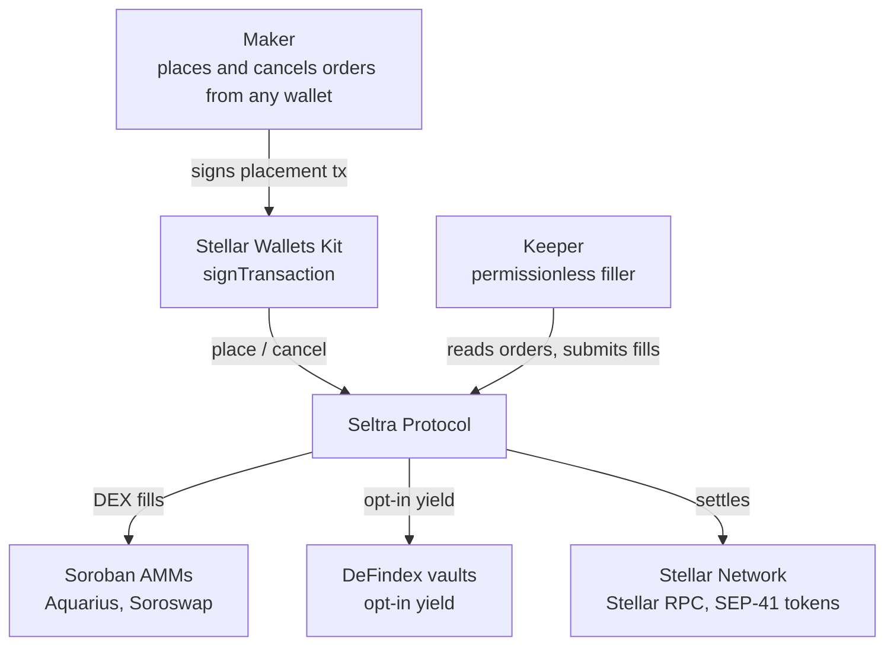
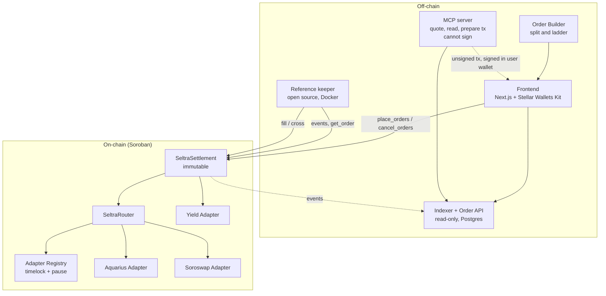
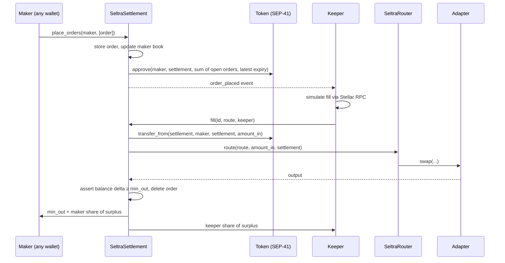
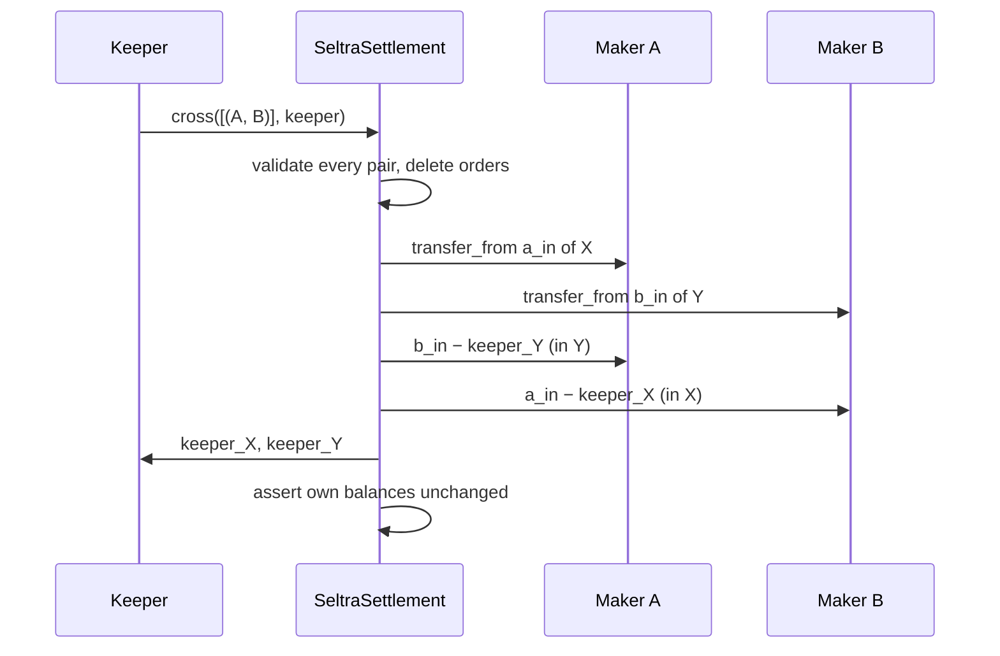

# Seltra — Technical Architecture

*Programmable limit orders on Soroban* · SCF Build submission (Open Track)

---

## Contents

1. [Overview](#1-overview)
2. [Design Constraints](#2-design-constraints)
3. [Contracts](#3-contracts)
4. [Flows](#4-flows)
5. [Keeper Economics](#5-keeper-economics)
6. [Keeper Network and Trust Assumptions](#6-keeper-network-and-trust-assumptions)
7. [Threat Model](#7-threat-model)
8. [Key Design Decisions](#8-key-design-decisions)
9. [Off-chain Components and Stack](#9-off-chain-components-and-stack)
10. [Testing](#10-testing)
11. [Integrations and Scope](#11-integrations-and-scope)
12. [Deliverables](#12-deliverables)

---

## 1. Overview

Seltra brings non-custodial limit orders to Soroban AMMs. A maker places an order with one ordinary transaction from any Stellar wallet: token pair, exact amount, minimum output, expiry. The order is stored in the Seltra contract and the funds stay in the maker's wallet; in the same transaction the contract sets its own SEP-41 allowance to exactly the sum of the maker's open orders on that token.

Permissionless **keepers** watch the orders and fill them when the market allows, in one of two ways:

- **DEX path**: the order is routed into Aquarius or Soroswap liquidity through an allowlisted venue adapter.
- **P2P path**: two opposite orders whose terms cross settle directly against each other, with no AMM and no pool fee.

The maker always receives at least the minimum; anything above it is surplus, shared between keeper and maker. Optionally, order by order, the capital behind a resting order earns yield in a DeFindex vault until the fill.

| Component | Role | Holds funds |
|---|---|---|
| **SeltraSettlement** | Stores orders, manages the allowance, executes fills, enforces `min_out`, pays the surplus split. Immutable | No (allowance only) |
| **SeltraRouter** | Calls venue adapters along the keeper's route | No |
| **Venue adapters** | One per AMM (Aquarius, Soroswap), common interface | No |
| **Adapter Registry** | Timelocked allowlist of adapters and vaults, guardian pause | No |
| **Yield adapter** | Opt-in deposit into and redemption from DeFindex vaults | No |
| **Keeper** | Open-source off-chain process: reads orders, simulates, submits fills | Own fees only |
| **Order API** | Read-only index of contract orders for the application | No |
| **MCP server** | Lets an AI assistant quote, read orders and prepare unsigned placement or cancellation transactions; it cannot sign | No |

### C4 L1: System Context

### C4 L2: Containers

---

## 2. Design Constraints

| Constraint | Consequence for the design |
|---|---|
| **One allowance per (owner, spender).** Each SEP-41 `approve` overwrites the previous one; on SACs it expires at a ledger capped by the network's maximum entry TTL (about 6 months on mainnet) | The contract computes the allowance as the sum of a maker's open orders on a token; the client never builds an `approve`. An order cannot rest longer than about 6 months. Revoking the allowance at the token kills every order on it |
| **Source-account authorization.** When the maker is the transaction's source account, the transaction signature authorizes the whole invocation tree | Placement works with any wallet that can sign a transaction; no authorization-entry signing |
| **Rented storage.** Every entry has a TTL; rent is not refunded | Orders and maker books live in temporary storage with a TTL covering their expiry, paid by the maker; the per-maker nonce is persistent. Expiry is checked in the stored value, never through TTL |
| **Footprint fixed at simulation** | No global counter: order ids are `(maker, nonce)` and nothing written by `place_orders` is shared between makers, so parallel placements never conflict |
| **Per-transaction limits** (mainnet, October 2026): 400M instructions, 40 MiB memory, 200 entries read / 200 written, 132 KB written, 16 KB events | Route depth, `MAX_CROSSES` and the 64 open orders per maker and token are constants, set from Tranche 1 measurements so that each operation at its bound uses at most 50 % of every limit |
| **Upgrades exist only if a contract implements them** | SeltraSettlement has no upgrade entrypoint: nobody can change the code that spends allowances. A fix means a new deployment and migration |

**Hardware.** A keeper runs on 1-2 vCPU and under 2 GB of memory, with any Stellar RPC endpoint, a funded account and channel accounts; it needs no archival history. A self-hosted Stellar RPC node needs 4-8 vCPU, 16 GB of memory and 350 GB of SSD at the default 7-day event retention. The indexer needs Postgres and must keep up with that retention window.

---

## 3. Contracts

### SeltraSettlement

The only contract in the custody path. Initialised by `__constructor` (guardian, registry); no upgrade entrypoint.

| Method | Caller | Behaviour |
|---|---|---|
| `place_orders(maker, Vec<OrderParams>) -> Vec<OrderId>` | Maker (`require_auth`) | Validates each order, assigns `(maker, nonce)` ids, stores orders with a TTL covering expiry, updates the maker book (pruning expired entries), then calls `approve(maker, settlement, sum of open orders, latest expiry)` on the spend token. In yield mode, deposits first through the yield adapter. Emits `order_placed` |
| `cancel_orders(maker, Vec<OrderId>)` | Maker | Deletes the orders and lowers the allowance through a fallible `try_approve`, so a token or vault that rejects the call cannot block cancellation. **Never pausable** |
| `fill(id, route, keeper)` | Anyone | DEX path, one order per call (section 4.1) |
| `cross(Vec<(OrderId, OrderId)>, keeper)` | Anyone | P2P path, up to `MAX_CROSSES` pairs per call (section 4.3) |
| `get_order(id)`, `open_orders(maker, token)` | Anyone | Read-only; lets a keeper verify any order without trusting the order API |
| `pause()`, `unpause()` | Guardian | Blocks `fill`, `cross` and `place_orders`. Never blocks cancellation, revocation at the token or expiry |

**Order**

| Field | Meaning |
|---|---|
| `id` | `(maker, nonce)` |
| `token_in`, `token_out` | SEP-41 contract addresses |
| `amount_in` | Exact input: the order fills entirely or not at all |
| `min_out` | Minimum output, measured as the settlement contract's balance delta |
| `expiry` | Last ledger at which the order can fill (≤ about 6 months) |
| `yield_source` | `None`, or an allowlisted DeFindex vault |
| `shares` | Yield mode only: vault shares committed to the order |
| `surplus_bps` | Keeper's share of surplus, default 7,000 (70 %) |

**Common to both fill paths.**
- The input is pulled with `transfer_from(settlement, maker, settlement, amount_in)`. The contract is both spender and direct caller, so no maker signature is needed at fill time.
- A balance-delta check confirms that exactly `amount_in` arrived, which rejects fee-on-transfer tokens.
- The output is measured by balance delta, never taken from an adapter's return value.
- A filled order is deleted. `transfer_from` lowers the allowance by exactly `amount_in`, so the allowance keeps matching the maker book.

### SeltraRouter and venue adapters

`route(route, amount_in, recipient)` executes the hops through adapters the registry reports active; an inactive or unknown adapter reverts before any token moves. `quote(route, amount_in)` is read-only. Each adapter exposes `swap(token_in, token_out, amount_in, min_out, to)` and `quote(...)`, and pre-authorizes the venue's pull of its tokens with `authorize_as_current_contract`, since Soroban only authorizes the direct call automatically.

| Venue | Wrapped entrypoint |
|---|---|
| **Aquarius** (first: ≈ $43M 30-day volume, DefiLlama, November 2026) | `swap_chained(user, swaps_chain, token_in, in_amount: u128, out_min: u128)`, amounts converted and range-checked |
| **Soroswap** | `swap_exact_tokens_for_tokens(amount_in, amount_out_min, path, to, deadline)` |

### Adapter Registry

`propose_adapter` / `activate_adapter` after a 72-hour timelock measured on the ledger timestamp, guardian `pause_adapter`, `is_active`. Vaults follow the same path (`propose_vault`, `activate_vault`, `pause_vault`). The guardian is a classic Stellar account with three signers on hardware wallets and a threshold of 2, which `require_auth` enforces natively: no multisig contract to trust.

### Yield adapter (opt-in)

- **Deposit**: inside `place_orders`, the adapter calls the DeFindex vault's `deposit(amounts, amounts_min, from = maker, invest = true)`. The shares are minted to the **maker's own account**, and the settlement contract sets its allowance on the share token.
- **Fill**: the settlement contract moves the order's shares to the adapter, which calls `withdraw` in the same invocation. The swap input is `min(redeemed, amount_in)`, absorbing the vault's rounding; whatever is redeemed above `amount_in`, the accrued yield, returns to the maker and is never shared with the keeper.
- **Allowed vaults**: single-asset vaults whose asset is `token_in`, deployed non-upgradable, activated behind the timelock, with a per-vault exposure cap tracked by the settlement contract.
- **Keepers** simulate `preview_redeem`, which runs the vault's real withdrawal path including the Blend unwind, and skip an order whose capital cannot be withdrawn right now.
- **On cancellation** the shares stay in the maker's account; the maker withdraws from the vault directly at any time.
- No Seltra contract holds shares between invocations.

---

## 4. Flows

### 4.1 Placement and DEX fill

Any failure reverts the whole transaction: the order and balances are unchanged, and the keeper has paid the fee of a failed transaction.

### 4.2 Batch placement: split and ladder

Several orders are placed in one `place_orders` call, signed once. A **split** places slices at the same price, so a large order fills progressively and fits thin pools. A **ladder** places orders at stepped prices on one pair. Each order is independent, can be cancelled alone, and is never re-placed automatically after a fill.

### 4.3 P2P cross

Notation: order A sells `a_in` of X for at least `a_min` of Y; order B sells `b_in` of Y for at least `b_min` of X.

**Validity rules**, checked for every pair before any token moves; one failure reverts the whole call.

| # | Rule |
|---|---|
| 1 | `cross` is not paused |
| 2 | `1 ≤ number of pairs ≤ MAX_CROSSES` |
| 3 | No order id appears twice in the call |
| 4 | Both orders exist and are not expired |
| 5 | Mirrored tokens: `A.token_in = B.token_out` and `A.token_out = B.token_in` |
| 6 | Both orders are in default mode (a yield-mode order fills through the DEX path only) |
| 7 | `b_in ≥ a_min` and `a_in ≥ b_min` |

**Payout.** `keeper_Y = (b_in − a_min) × A.surplus_bps / 10,000` and `keeper_X = (a_in − b_min) × B.surplus_bps / 10,000`, rounded down. A receives `b_in − keeper_Y`, B receives `a_in − keeper_X`; a zero keeper share is not transferred. Each surplus is in that maker's own `token_out`: no exchange rate, no conversion between decimals, exact conservation in each token.

**Order of operations**: validate → delete orders and update maker books → pull inputs with delta checks → pay → assert settlement balances unchanged.

**Boundaries**: whole orders only, one order against one order; standard slice sizes from the split mode make such matches frequent. A cross reads about 20 entries and writes about 14, a tenth of the limits, and calls no AMM.

---

## 5. Keeper Economics

- The maker always receives at least `min_out`. Surplus is everything above it.
- The keeper receives `surplus × surplus_bps / 10,000`, rounded down; the maker receives the rest. Default **7,000 (70 % keeper / 30 % maker)**, set per order and visible on-chain.
- **Why the keeper gets the larger share**: the maker's price is already guaranteed, while keepers pay for infrastructure, RPC and the fees of lost races. A high share makes independent keepers viable at low volume.
- **The maker pays** the placement fee and the order's rent, once, in XLM: about 0.02-0.03 XLM for a 7-day order and 0.1 XLM for 6 months at current settings. Nothing at fill time.
- **Minimum order size: $10** per order and per slice, enforced by the application from the venue quote, not by the contract (which would need an oracle). Below that, a fill may not cover a keeper's fee.
- The protocol takes no fee, and the contract has no fee parameter.

*DEX example*: an order sells 1,000 XLM with `min_out` 500 USDC; the route returns 507 USDC. The maker receives 502.1 USDC, the keeper 4.9 USDC.

*P2P example*: A sells 1,000 XLM for at least 290 USDC; B sells 300 USDC for at least 980 XLM. A receives 293 USDC, B 986 XLM, the keeper 7 USDC and 14 XLM.

---

## 6. Keeper Network and Trust Assumptions

**What a keeper can do**: choose which orders it fills, when, and through which allowlisted route. It cannot hold funds, change an order, pay less than `min_out`, use a non-allowlisted venue, or fill a cancelled or expired order. The first valid fill wins; a second fill of the same order fails. Stellar shuffles the apply order within a ledger, so speed matters at ledger granularity (~5 s), not milliseconds.

**Discovery without Seltra**: keepers read `order_placed` events from any Stellar RPC (7-day retention by default, matching the default expiry) and verify each order with `get_order`. Older orders are found through any event index. The order API is a convenience, never a dependency.

| Decentralisation measure | Tranche |
|---|---|
| Orders on-chain, readable from any RPC | T1 |
| Reference keeper open-sourced, one-command Docker image, runs with the order API switched off | T2 |
| Public metrics: distinct keeper addresses, largest keeper's share, last fill age | T2 |
| Self-fill from the application, so a maker never depends on a keeper | T2 |
| Two of the three launch keepers operated outside the team, proven on-chain | T3 |
| Team backstop keeper with no privilege | ongoing |

| Phase | What the user trusts | What the user never has to trust |
|---|---|---|
| Testnet | The contracts | Custody, keepers, the Seltra frontend and API |
| Mainnet | The immutable settlement contract and its bounded allowance; a 2-of-3 guardian (pause only) with one signer outside the team, addresses published; allowlist changes public and timelocked 72 hours; in yield mode, the chosen vault | Keepers (cannot take or underpay); venues (a compromised adapter can only fail a fill) |
| After this award | Same contracts; open set of keeper operators; a majority of guardian signers outside the team | Same as mainnet |

---

## 7. Threat Model

The full STRIDE threat model is a Tranche 1 deliverable. The attacker is assumed to control every argument, transaction ordering and timing, and contracts mimicking any interface; the host rules out cross-contract re-entry and replay.

| Threat | Protection |
|---|---|
| Draining the contract | No value rests in any Seltra contract between invocations (invariant 11) |
| Excessive allowance | Computed on-chain, equal to open orders, never unlimited, expires with the latest order |
| Malicious adapter or token | Input and output measured by balance delta; a malicious token can only affect orders that name it |
| Bad actor: places attractive orders, then empties the account, revokes the allowance or pulls pool liquidity | No funds of any other user are ever committed before the atomic fill: the fill reverts and nothing moves. In a cross, the counterparty order stays resting untouched. Only the keeper loses a failed-transaction fee, and simulation (free) detects it first; the order API flags unbacked orders |
| Oracle manipulation | No oracle in the settlement path: price comes from the venue and is judged against `min_out`. Oracle exposure exists only in opt-in yield mode, through the vault's lending pool |
| Thin AMM liquidity | An order larger than a pool returns at `min_out` simply waits; keepers skip it after simulation. Slicing fits orders to depth; Aquarius first because it holds Soroban liquidity |
| AMM price manipulation | An order only executes at ≥ `min_out`; worst case is forgone surplus, never principal. Short default expiry, market-based default `min_out`, slicing, keeper competition |
| Spam | Every order costs its creator rent; 64 open orders per maker and token |
| Compromised AI agent or MCP server | It cannot sign: every placement or cancellation is a transaction the user signs in their own wallet, which displays the call and its allowance |
| Hostile guardian | Can pause fills and placements, never cancellation, revocation or expiry |
| Missing trustline; issuer freeze or clawback on a classic asset | The fill reverts and nothing moves; keepers skip it after simulation. The application reads the issuer's flags and shows them before signing. Cancellation still works (`try_approve`) |
| Illiquid vault (yield) | `preview_redeem` simulated; order shown as "waiting on liquidity"; maker can withdraw directly |

**Where a user can lose funds**
1. **Phished frontend** making the user place an order with a worthless `min_out`; the allowance obtained is limited to that order.
2. **Defect in the settlement fill path**: exposure limited to the maker's open orders on that token, never the rest of the wallet. First focus of the independent review obtained through Stellar's security review programme for SCF-funded protocols.
3. **Issuer action** on a classic asset (clawback, freeze).
4. **Vault loss** in yield mode, accepted when opting in, capped per vault.

**Invariants proven by the test suite**
1. A maker never receives less than `min_out`.
2. Conservation: exactly `amount_in` (or `shares`) leaves the maker on a fill, nothing otherwise; output = `min_out` + maker surplus + keeper surplus.
3. After every placement or cancellation the allowance equals the sum of open orders, is never unlimited; at most 64 open orders per token.
4. `transfer_from` is reached only in `fill` and `cross`, for exactly `amount_in`; an order fills at most once.
5. Only the maker can cancel; a cancelled, filled or expired order never fills.
6. `pause` never blocks cancellation, revocation or expiry.
7. A route through an inactive adapter reverts before any token moves.
8. A malicious adapter leaves the maker's balances unchanged.
9. An order id is never reused (persistent nonce, restored, never reset).
10. P2P: every successful `cross` satisfies the 7 rules of section 4.3 and conserves each token exactly; one invalid pair reverts the whole call.
11. Settlement, router and adapter balances are unchanged after every invocation.
12. Yield: redemption and fill are atomic; input = `min(redeemed, amount_in)`; yield goes to the maker, never to the keeper.
13. Yield: a deposit above the cap, or into a paused, multi-asset or upgradable vault, reverts.

---

## 8. Key Design Decisions

| Decision | Why | Alternative rejected |
|---|---|---|
| **On-chain orders, contract-managed allowance** | Works with every wallet (authorization-entry signing is missing from Lobstr, xBull, Albedo and the kit's Ledger module); orders readable without a Seltra service; costs cents on Stellar | Off-chain signed orders (unsupported by those wallets, central order book); escrow (honeypot) |
| **Exact amount; progressive execution by slices** | No remainder logic in the custody path | Partial fills of one order |
| **No DCA, no automatic re-placement** | A DCA needs a start date and a loose `min_out` that would hand the "surplus" to the keeper; re-placing needs a new maker signature | DCA, grid bot |
| **Per-order cancellation, never pausable** | Trustless; revocation at the token is a second kill switch | Global epoch |
| **Expiry ≤ ~6 months, 7 days by default** | Bounded by the SAC allowance; a long-lived order drifts from the market | Open-ended orders |
| **Temporary storage, `(maker, nonce)` ids** | Half the rent, no global contention | Global counter |
| **First valid fill wins** | Simple, no coordinator | Solver auction |
| **Separate `fill` and `cross` entrypoints** | Each path has its own arguments and tests | One entrypoint with an optional route |
| **Aquarius first, Soroswap second, both in T1** | Aquarius holds Soroban liquidity today | — |
| **Immutable settlement** | Nobody can change the code that spends allowances | Upgradeable contract |
| **Opt-in yield, shares in the maker's wallet** | No honeypot; waiting capital earns | Pooled vault run by Seltra |
| **No protocol fee parameter** | No admin power over maker economics in an immutable contract; a future fee would ship as a new contract version, and every order expires within about 6 months | Fee set to 0 behind the timelock |

---

## 9. Off-chain Components and Stack

| Layer | Content |
|---|---|
| Contracts | Rust, Soroban SDK, WASM; `stellar-cli` for build, deployment and TypeScript client generation |
| Frontend | Next.js, TypeScript, Stellar Wallets Kit (`signTransaction`). Committed: Freighter, Lobstr, xBull, Albedo, Hana, Ledger (clear signing, `nonBlindTx`; ladders split to fit the Nano S size limit). Before signing: network passphrase and contract addresses checked, trustline, allowance and rent shown. "Execute now" for self-fill |
| Order Builder | TypeScript: split and ladder into one `place_orders` batch, $10 minimum per slice |
| Keeper | Node.js/TypeScript, Docker: events and `get_order` via Stellar RPC, quotes from both venues, P2P matching by pair, simulation, submission through channel accounts |
| Order API and indexer | Node.js, PostgreSQL: read-only REST/WebSocket, unbacked orders flagged, keeper metrics |
| MCP server | TypeScript, Model Context Protocol: tools `quote`, `list_orders`, `get_order`, `prepare_place`, `prepare_cancel`; returns unsigned transaction XDR, holds no key |
| Infrastructure | Self-hosted Stellar RPC + fallback provider; Docker, CI |

---

## 10. Testing

- **Unit**: placement, cancellation, allowance, expiry, `min_out`, surplus split, pause.
- **Adversarial**: replayed or double fills, fills one unit short of `min_out`, malicious adapters, fee-on-transfer and lying tokens, missing trustline, revocation at the token, cancellation while `approve` is rejected.
- **P2P**: one test per rule of section 4.3, a batch whose last pair is invalid, exact conservation, zero shares, tokens with different decimals.
- **Fuzz and property**: ≥ 100,000 iterations over placements, cancellations, fills, crosses and expiries; the allowance always equals open orders.
- **Archival**: nonce restored, never reset.
- **Integration**: local network then testnet; both venues, P2P, a partially cancelled ladder, self-fill, yield against the real DeFindex and Blend contracts. The public testnet pools of Aquarius and Soroswap use different test USDC, so a re-runnable script issues a test stable asset and seeds XLM pools on both venues, one deliberately thin; it is re-run after a testnet reset.
- **Resources**: deepest route, single cross, `cross` at `MAX_CROSSES`, 20-order ladder, each ≤ 50 % of every limit.
- **CI**: Rust and TypeScript suites and static analysis on every push, public results; every threat in the threat model maps to a named test.
- **External review**: core contracts frozen at the end of Tranche 1, the yield adapter at the end of Tranche 2, each reviewed on its frozen commit.

---

## 11. Integrations and Scope

| Integration | Role |
|---|---|
| Aquarius, Soroswap | Venue adapters (T1) |
| DeFindex | Opt-in yield (T2) |
| Stellar Wallets Kit | Signing of placement and cancellation (T2) |
| SEP-41 / SAC | Transfers and the managed allowance |
| Stellar RPC | Discovery, simulation, events, submission |

**Out of scope**: off-chain signed orders, DCA, automatic re-placement, partial or one-to-many crosses, vaults other than DeFindex, venues other than Aquarius and Soroswap, stop orders, keeper bonding or token incentives, solver auction, automatic renewal, protocol fee, third-party SDK, metered API access, any agent holding a user key.

---

## 12. Deliverables

Dates, completion criteria and budgets are in [MILESTONES.md](./MILESTONES.md).

| Tranche | Deliverables | Sections |
|---|---|---|
| T1: Settlement core, venues, threat model | 1.1 SeltraSettlement · 1.2 Router, registry, Aquarius and Soroswap adapters · 1.3 Threat model | §2, §3, §4, §7, §8 |
| T2: Testnet, open keepers, yield | 2.1 Testnet deployment and reference keeper · 2.2 Placement flow, order API, Order Builder, MCP server, application · 2.3 Yield adapter | §3, §4.2, §5, §6, §9 |
| T3: Mainnet | 3.1 Hardened contracts and mainnet deployment · 3.2 Production application, wallet integration and yield mode · 3.3 Keeper network and independent operators | §6, §7 |
